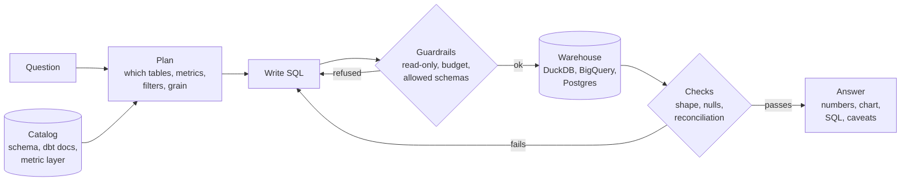

# data-analyst-agent

An open-source AI agent that answers business questions on your data warehouse. Ask "Which
products drove the drop in on-time deliveries last quarter?" and it finds the right tables,
writes SQL, runs it read-only, checks the result, and explains the answer with the query
it used, so you can verify every number.

> **Status:** the core loop works on DuckDB: guardrails, a read-only warehouse, a provider
> interface and `analyst ask` are built and tested, and `analyst bench` scores the agent
> on a question suite. Grounding in dbt docs and metric layers and result checks come
> next. No model accuracy figure appears here until the benchmark has produced it.

## Why another text-to-SQL tool

Text-to-SQL demos look good on clean, single-table examples. Real warehouses are where
they fail: dozens of models with similar names, metrics with precise business definitions,
type 2 dimensions, timestamps in mixed time zones. A wrong answer that looks right is worse
than no answer. This project is built around that:

- **It knows your definitions.** It reads dbt docs and a metric layer (for example a
  `metrics.yml`) before writing SQL, so "SLA attainment" means what your team means.
- **It checks itself.** Every result goes through sanity checks (row counts, nulls,
  reconciliation against known totals) and the agent revises the query when a check fails.
- **It cannot change your data.** Read-only credentials, every statement parsed and
  refused unless it is a single `SELECT`, row and cost budgets, timeouts.
- **It is measured.** A public benchmark of realistic questions over real dbt warehouses,
  with gold queries, scored by execution accuracy, published per model and per release.
- **It runs with the model you choose.** Hosted APIs or a local open model through an
  OpenAI-compatible endpoint, with no code changes.

## How it works



Every step is traced, so a run can be replayed and audited: the plan, each query, each
check and why it passed or failed.

## Interfaces

```bash
pip install -e .                           # not published to PyPI yet
export ANALYST_BASE_URL=http://localhost:11434/v1 ANALYST_MODEL=<model>   # any OpenAI-compatible endpoint
analyst ask "What was SLA attainment by tier last month?" \
  --warehouse duckdb:///support.duckdb --schema marts      # works today
analyst bench --suite support-bi --model <provider:model>   # planned, M2
analyst mcp                                # planned, M3: serve the agent to other agents
```

## Benchmark

The benchmark uses warehouses built by two companion projects, so the questions sit on
realistic, tested dbt models rather than toy tables:

| Suite | Warehouse | What makes it hard |
|---|---|---|
| support-bi | [cloud-support-bi](https://github.com/mohammadazam7/cloud-support-bi) | type 2 customer tiers, SLA targets by priority and tier, additive metric components |
| commerce | [ecommerce-data-ai-platform](https://github.com/mohammadazam7/ecommerce-data-ai-platform) | nine source tables, per-order customer ids, out-of-order milestones, Portuguese category names |

Each question has a gold query; an answer counts as correct when its result matches the
gold result, with column names, column order and (unless the question asks for an
order) row order ignored. There are two suites of 12 questions so far,
[commerce](benchmarks/commerce) and [support-bi](benchmarks/support-bi).

```bash
# check the suite and the harness: answering with the gold queries must score 12 of 12
analyst bench benchmarks/commerce/questions.toml --warehouse duckdb:///commerce.duckdb --gold
# score a model behind any OpenAI-compatible endpoint
ANALYST_BASE_URL=http://localhost:8080/v1 ANALYST_MODEL=my-model \
  analyst bench benchmarks/commerce/questions.toml --warehouse duckdb:///commerce.duckdb \
  --out results.md --hardware "what it ran on"
```

The gold run scores 12 of 12 on each suite's warehouse, which checks the suites and
the harness, not any model. No model has been scored yet; results
will be reported by model, with latency per question, once they have been measured.

## Documentation

- [Design doc](docs/design.md): goals, non-goals, design, alternatives, safety, testing plan
- [Roadmap](docs/ROADMAP.md): milestones and dates

## Development

```bash
python -m venv .venv && source .venv/bin/activate
make install
make check
```

See [CONTRIBUTING.md](CONTRIBUTING.md) and [SECURITY.md](SECURITY.md).

## License

MIT
